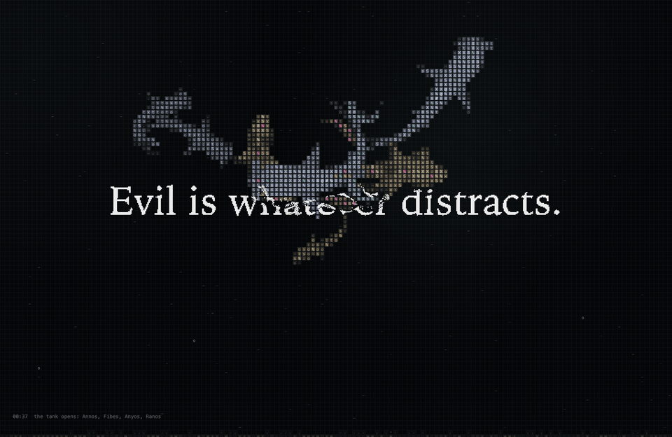

# Living Wallpaper

A live ASCII aquarium for your desktop, on **macOS, Windows and Linux**.

Hammerhead and leopard sharks swim behind your desktop icons. They're made of tiny monospace tiles, and they swim through a line of text, *"Evil is whatever distracts."*, tearing up the letters, which settle back afterwards. The text is yours to change.

The sharks live in families. They have babies, grow up, get hungry, die, and sink to the sand, where they crumble into food for the others. The whole family tree is kept in a SQLite database.



## What you can do

| You do | What happens |
| --- | --- |
| Move the cursor over the desktop | Adult sharks swim over and circle it. |
| Click open water | Food pellets sink. Hungry sharks, babies too, race for them. |
| Click a shark | You love it. Hearts rise, it does a happy swirl, and its name tag shows (`name · gen · family · age ♥`). |
| Edit `quote.txt` | The words change on the wallpaper within 2 seconds. |
| Do nothing | Life goes on. Babies grow, adults pair up, the old die and become food. |

## Install

```sh
git clone https://github.com/ri-ru/living-wallpaper.git
cd living-wallpaper
```

| OS | Needs | Install | Remove |
| --- | --- | --- | --- |
| **macOS** 13+ | Xcode Command Line Tools (`xcode-select --install`) | `./install.sh` | `./uninstall.sh` |
| **Windows** 10/11 | [.NET 8 SDK](https://dotnet.microsoft.com/download) (`winget install Microsoft.DotNet.SDK.8`); WebView2 is built into Windows 11 | `.\install.ps1` in PowerShell | `.\uninstall.ps1` |
| **Linux** | Python 3, GTK 3, WebKitGTK; optionally gtk-layer-shell (see below) | `./install.sh` | `./uninstall.sh` |

Linux packages:

```sh
sudo apt install python3-gi gir1.2-webkit2-4.1 gir1.2-gtklayershell-0.1     # Debian, Ubuntu
sudo dnf install python3-gobject webkit2gtk4.1 gtk-layer-shell               # Fedora
sudo pacman -S python-gobject webkit2gtk-4.1 gtk-layer-shell                 # Arch
```

Each installer:

- builds or prepares the host
- starts the wallpaper now
- makes it start at every login: a LaunchAgent on macOS, a Startup shortcut on Windows, an XDG autostart entry on Linux

Uninstalling keeps your tank and your quote.

**Just want to look?** Open `web/index.html` in any browser. Everything works except saving. Add `?quote=Your%20words` to the URL to try other words.

### Where it works

| Platform | How it sits behind the icons | Tested |
| --- | --- | --- |
| macOS | desktop-level window | ✅ daily use (M4 MacBook Air) + CI |
| Windows 11 24H2+ | child of Progman below the icon view | ✅ CI desktop (build 26100, [screenshot](docs/ci/windows-desktop-attach.png)); not yet on a home PC |
| Windows 10 / 11 before 24H2 | child of the WorkerW behind the icons | not yet tested |
| KDE Plasma, Sway, Hyprland and other wlroots desktops (Wayland) | layer-shell background layer | not yet on real hardware |
| X11 desktops (Xfce, Cinnamon, MATE, GNOME on X11 …) | desktop-type window | ✅ Docker (Xvfb) + CI ([screenshot](docs/ci/linux.png)) |
| GNOME on Wayland | desktop-type window through XWayland | not verified |

If you try it somewhere not marked ✅, please open an issue with what you saw and the log file (paths below). The details per OS are in [docs/RESEARCH.md](docs/RESEARCH.md).

## Change the words

The words come from a plain text file that is created on first run:

| OS | `quote.txt` |
| --- | --- |
| macOS | `~/Library/Application Support/LivingWallpaper/quote.txt` |
| Windows | `%APPDATA%\LivingWallpaper\quote.txt` |
| Linux | `~/.config/living-wallpaper/quote.txt` |

Save the file and the wallpaper shows the new words within 2 seconds. You don't need to restart. Line breaks are kept, so put each line where you want it.

## Lock screen

A lock screen can't run a live page on any of the three systems. So the wallpaper keeps the lock-screen picture set to **just the words**: crisp, on the tank's dark background, with no sharks. It updates the picture every 5 minutes, when you lock, and when the screen or the computer goes to sleep. If you change `quote.txt`, the lock screen follows.

| OS | How | Status |
| --- | --- | --- |
| macOS | The lock screen shows the desktop picture, which is hidden behind the aquarium, so the host sets the desktop picture. | ✅ |
| Windows | `Windows.System.UserProfile.LockScreen.SetImageFileAsync` | builds in CI; not yet tried on a PC (some editions or policies block it; see the log) |
| Linux (GNOME) | the `org.gnome.desktop.screensaver picture-uri` setting | written; not yet tried on a GNOME desktop |
| Linux (other) | no common way; skipped | — |

Your previous picture is saved the first time, and uninstalling puts it back. Run the host with `--no-lockscreen` to leave the lock screen alone.

## Make it yours

| Change | Where |
| --- | --- |
| The words | `quote.txt` (above) |
| Frame rate, cell size | `QUERY="fps=10&cell=12" ./install.sh` (PowerShell: `$env:QUERY="fps=10"; .\install.ps1`) |
| Lifespan, growth time, birth rate, cooldown, population cap, newcomer threshold | constants at the top of `web/index.html`: `LIFE_HOURS`, `GROW_SECONDS`, `NATURAL_BIRTHS_PER_HOUR`, `BREED_COOLDOWN_HOURS`, `MAX_SHARKS`, `MIN_ALIVE` |
| Sinking and decay | `SINK_SPEED`, `REST_MS`, `DECAY_MS` in `web/index.html` |
| Colours | `HUES`, `FAMILY_HUES` in `web/index.html` |
| Shark shape | `width()` and `drawShark()` in `web/index.html` |
| A completely different scene | Replace `web/index.html`. The hosts show any page that follows [the host contract](docs/HOST_PROTOCOL.md). |

Changes to `web/` show up after a restart:

- macOS: `launchctl kickstart -k gui/$(id -u)/io.github.ri-ru.living-wallpaper`
- Windows and Linux: run the installer again

## Life in the tank

- **Families.** The tank opens with four founding families. Every shark has a name, a generation and two parents. A few tiles along its back show its family colour.
- **Every shark looks a little different.** Each one has its own build (slender to stout), fin size, tail length, hammer width, swimming speed, colour tint and spot pattern. Rarely, one is born **pale** or **dark**. Children inherit a blend of both parents, with small mutations. Click a shark to see its traits on the name tag, for example `Tiki · gen 3 · Anfis · 2d4h · pale, broad-finned ♥`.
- **Growing up.** Babies swim beside a parent and take about 36 hours to grow up. Food speeds that up a little.
- **Children.** Grown sharks of the same species pair up on their own, about 3–4 births a day across the tank. Each adult has at most one child a day. Well-fed sharks you have loved are likelier to have children. Siblings never pair. Breeding stops at 24 living sharks.
- **A week of life.** Each shark lives 6–8 days of real time. When it dies, it turns grey, sinks, rests on the sand, and crumbles into food for the others.
- **Time away keeps counting.** When the computer sleeps or is off, the tank replays the missing time when the wallpaper starts again. Sharks born while you were away appear at the age they would be now. Sharks whose time ran out are recorded as dying at that moment, quietly, without a wave of sinking bodies. The log shows these events as "while you were away: …".
- **Newcomers.** If fewer than 3 sharks are alive, a new family drifts in from the edge.
- **Feasting.** Sharks that swim through the words get a little less hungry.

All of these numbers are constants at the top of `web/index.html`.

## The family tree (SQLite)

| OS | `tank.sqlite` |
| --- | --- |
| macOS | `~/Library/Application Support/LivingWallpaper/` |
| Windows | `%APPDATA%\LivingWallpaper\` |
| Linux | `~/.local/share/living-wallpaper/` |

| Table / view | Contents |
| --- | --- |
| `families` | `id, name, hue, founded_at` |
| `sharks` | `id, name, species, family_id → families, generation, parent_a_id → sharks, parent_b_id → sharks, born_at, lifespan_hours, died_at, length, adult_length, fullness, love` |
| `shark_traits` | `shark_id → sharks, girth, fins, tail, head, speed, tint_r, tint_g, tint_b, variant (common/pale/dark), pattern_seed` |
| `events` | `id, at, kind, shark_id → sharks, text`. Kinds: `opened`, `arrived`, `born`, `fed`, `loved`, `died`, `returned`. |
| `meta` | `last_seen_ms` (when the wallpaper last ran, for replaying time away) |
| `babies` (view) | every shark that has parents, with the parents' and family's names |
| `alive` (view) | sharks that have not died |

```sh
sqlite3 -header -column ~/Library/Application\ Support/LivingWallpaper/tank.sqlite "select * from babies"
sqlite3 -header -column ~/Library/Application\ Support/LivingWallpaper/tank.sqlite "select at, text from events order by id desc limit 20"
```

To start a fresh tank, uninstall, move `tank.sqlite` away, and install again.

## How it works

```
web/                      the scene, same on every OS
  index.html              canvas aquarium: sharks, words, families, life and death
  schema.sql, load.json   all the SQL (hosts only run what the page gives them)
hosts/
  macos/main.swift        WKWebView at desktop window level
  windows/Program.cs      WebView2 attached behind the icons (WorkerW / Progman)
  linux/living_wallpaper.py  WebKitGTK on the layer-shell background, or a desktop-type window
docs/
  HOST_PROTOCOL.md        what a host must do; write one for another platform
  RESEARCH.md             how live wallpapers work on each OS, existing tools, problems found
```

- **Sharks.** Each shark has a spine of 26 points. Every point follows the one in front of it, and a wave runs down the tail.
- **ASCII tiles.** Each frame, the sharks are drawn into a tiny canvas with one pixel per grid cell. Each lit cell becomes a monospace glyph tile, chosen by its brightness.
- **The words** are a few thousand 2-px dots on springs.
- **Hosts.** Each host is 250–400 lines and does six things: show the page behind the desktop, inject start-up data, run SQL transactions, forward the mouse where needed, watch `quote.txt`, and recover after sleep. See [docs/HOST_PROTOCOL.md](docs/HOST_PROTOCOL.md).
- **CI.** [CI](.github/workflows/ci.yml) builds and runs all three hosts on real macOS, Linux and Windows machines on every push. Each run clicks, changes the quote, and checks the database.

## Cost

On an M4 MacBook Air: about 32% of one CPU core at 15 fps while the desktop is visible. When windows cover the desktop completely, the web engine stops drawing. Use `fps=10` for less.

## Troubleshooting

| Problem | Try |
| --- | --- |
| Nothing shows | Read the log: macOS `~/Library/Logs/living-wallpaper/err.log`, Windows `%APPDATA%\LivingWallpaper\log.txt`, Linux `~/.local/state/living-wallpaper/log.txt`. |
| Blank after the computer wakes | The hosts reload after sleep. If it stays blank, restart the wallpaper and open an issue with the log. |
| macOS: "this SDK is not supported by the compiler" | The Command Line Tools shipped an SDK newer than their compiler. `install.sh` falls back to an installed macOS 15 SDK; otherwise update the Command Line Tools. |
| Windows: black wallpaper | Edit the Startup shortcut and add `--no-layered` to its arguments (see RESEARCH.md §3). |
| Try it without installing | Run the host with `--windowed`, for example `python3 hosts/linux/living_wallpaper.py --windowed`. |

## Credits

The ASCII sharks were inspired by a shark animation that [@stackedlol](https://x.com/stackedlol/status/2113123074115830201) posted on X. The default words are from Franz Kafka's Zürau aphorisms. All code here is original and MIT-licensed.
